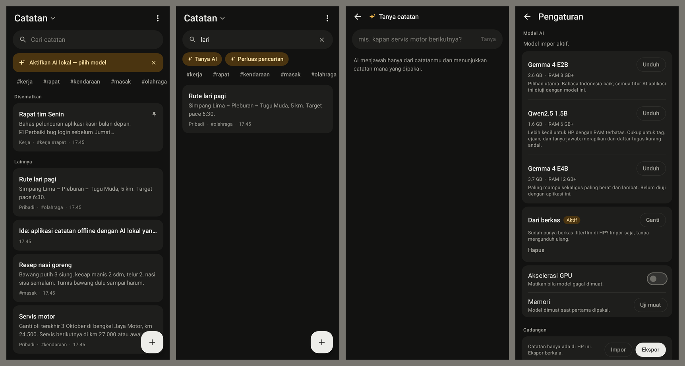

# Catatanku

Aplikasi catatan pribadi Android yang bekerja offline, dengan asisten AI yang berjalan sepenuhnya di perangkat.




## Fitur

**Catatan**
- Simpan otomatis, sematkan, folder, tag, arsip, dan sampah (pulih dalam 30 hari)
- Daftar centang dan poin, hitung kata, urutkan
- Bagikan/salin, terima teks dari aplikasi lain, ekspor/impor JSON
- Tekan lama kartu untuk aksi cepat

**Pencarian** — tanpa model, instan
- TF-IDF kata + trigram karakter: "lari" menemukan "berlari", salah ketik ringan ditoleransi
- Catatan terkait muncul otomatis di editor

**AI lokal** — opsional, butuh model
- *Bantu tulis*: lanjutkan, perbaiki ejaan, rapikan struktur, ringkas, ambil daftar tugas, buat judul, instruksi bebas
- *Merapikan*: isi judul, folder, dan tag yang kosong untuk satu atau semua catatan
- *Tanya catatan*: jawaban dari hingga 4 catatan paling relevan, lengkap dengan sumbernya
- *Perluas pencarian*: "jogging" → "lari, olahraga"

Hasil AI selalu ditinjau dulu sebelum diterapkan; "Ganti isi" bisa diurungkan, dan merapikan tidak pernah menimpa isian yang sudah ada.

## Model AI

Pengaturan → Model AI → **Unduh**. Unduhan berjalan di latar, lanjut otomatis bila koneksi putus, dan diverifikasi SHA-256.

| Model | Ukuran | Anjuran RAM* | Catatan |
|---|---|---|---|
| Gemma 4 E2B | 2,6 GB | 8 GB | Pilihan utama; prompt aplikasi diuji dengan model ini |
| Qwen2.5 1.5B | 1,6 GB | 6 GB | Lebih ringan; merapikan & daftar tugas kurang andal |
| Gemma 4 E4B | 3,7 GB | 12 GB | Paling berat; belum diuji |

\* Perkiraan, belum diukur di perangkat.

Semua berlisensi Apache-2.0 dari [litert-community](https://huggingface.co/litert-community) dan bisa diunduh tanpa login.
Sudah punya berkas `.litertlm`? Pakai **Dari berkas**.

## Privasi

Catatan dan pemrosesan AI tetap di perangkat. Izin internet hanya dipakai untuk mengunduh berkas model saat
pengguna memintanya, lewat `DownloadManager` Android; kode aplikasi tidak membuka koneksi sendiri. Cadangan cloud
Android dimatikan. Untuk varian tanpa izin internet sama sekali, hapus `uses-permission INTERNET` di manifest —
impor model dari berkas tetap berfungsi.

## Build

Butuh JDK 17+ dan Android SDK 36.

```bash
./gradlew assembleDebug        # APK: app/build/outputs/apk/debug/
./gradlew testDebugUnitTest    # uji logika + render layar
./gradlew testDebugUnitTest --tests '*Shots*' -Pshots=true   # tangkapan layar → app/build/shots/
```

Versi: AGP 8.13.2 · Kotlin 2.4.21 · Compose BOM 2025.10.01 · LiteRT-LM 0.19.1 · minSdk 26.
APK hanya memuat `arm64-v8a`; hapus `abiFilters` di `app/build.gradle.kts` untuk emulator x86_64.

## Status pengujian

| Bagian | Status |
|---|---|
| Mesin pencarian, pengurai keluaran AI, katalog model | Uji unit otomatis |
| Tampilan 10 layar, terang & gelap | Dirender otomatis (Robolectric + Roborazzi) |
| Prompt AI dengan Gemma 4 E2B dan Qwen2.5 1.5B | Diuji di desktop lewat `litertlm-jvm` |
| Migrasi database v1 → v2 | SQL diuji pada skema lama |
| Aplikasi di HP sungguhan (sentuhan, unduhan, kecepatan, RAM) | **Belum diuji** |

## Dokumentasi

- [Arsitektur](docs/ARSITEKTUR.md) — struktur kode, alur data, keputusan desain
- [Riwayat perubahan](CHANGELOG.md)
