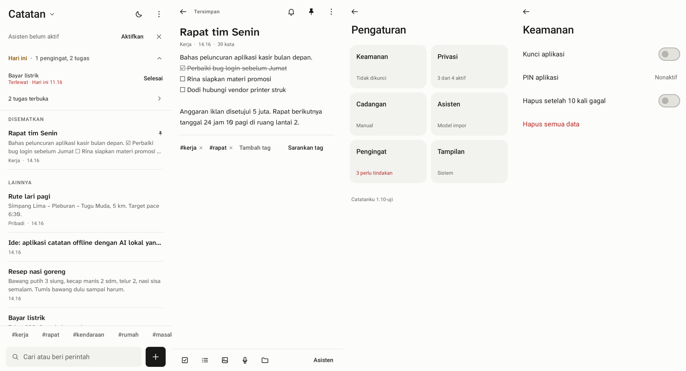

<div align="center">


# Catatanku

**Catatan pribadi yang bekerja offline, dengan AI yang berjalan sepenuhnya di HP.**

*An offline-first Android notes app with reminders and an on-device AI assistant. No account, no cloud, no tracking.*

[](CHANGELOG.md)
[](#pasang)
[](LICENSE)
[](#privasi)

### [Unduh Catatanku 1.7.1 (APK, 24,9 MB)](https://github.com/papertop221/Catatanku/releases/download/v1.7.1/Catatanku-1.7.1.apk)

Android 8.0 ke atas · arm64 · [Riwayat perubahan](CHANGELOG.md)

</div>




## Sekilas

| | |
|---|---|
| **Milikmu sendiri** | Tanpa akun dan tanpa server. Catatan, pengingat, dan pemrosesan AI tidak pernah keluar dari HP. |
| **Tidak kelupaan** | Pengingat sekali atau berulang, gaya alarm, mode tahan penghemat baterai, dan blok "Hari ini" untuk yang terlewat dan tugas yang belum selesai. |
| **Cukup diketik** | "ingatkan saya bayar listrik besok jam 7 malam" di kolom cari menjadi catatan berpengingat, setelah kamu setujui. |
| **AI yang membantu, bukan mengambil alih** | Ringkas, perbaiki ejaan, ambil daftar tugas, tanya catatan — juga langsung dari menu teks terpilih di aplikasi lain. Hasil selalu ditinjau dulu dan bisa diurungkan. |
| **Ringan** | APK 24,9 MB. Pencarian instan tanpa model; dekode media dan indeks ditunda hemat RAM untuk HP berspesifikasi rendah; AI hanya memakai RAM saat dipakai. |

**Isi:** [Filosofi](#filosofi) · [Pasang](#pasang) · [Fitur](#fitur) · [Model AI](#model-ai) · [Privasi](#privasi) · [Build](#build) · [Status pengujian](#status-pengujian) · [Dokumentasi](#dokumentasi) · [Lisensi](#lisensi)

## Filosofi

Catatanku dibangun di atas lima pilar yang menjadi standar wajib setiap perubahan kode maupun fitur (lihat [Filosofi & Standar Pengembangan](docs/FILOSOFI.md) dan [AGENTS.md](AGENTS.md)):

- **Praktis:** Buka, tulis, selesai — simpan otomatis tanpa tombol simpan, ketuk langsung kotak centang, selalu bisa diurungkan, dan menyatu dengan menu bagikan, teks terpilih, serta Setelan Cepat Android.
- **Efektif & Efisien:** Tetap responsif dan hemat RAM bahkan di HP berspesifikasi rendah (dekode gambar asinkron/subsampled, cadangan & audio *streaming*, transaksi SQLite, pembaruan indeks ditunda saat mengetik, tanpa dependensi berat).
- **Canggih:** AI lokal (teks, gambar, suara) yang benar-benar membantu dan terintegrasi sistem, bukan gimmick visual; waktu dan pencarian instan tetap dikerjakan kode deterministik.
- **100% Privasi:** Offline-first tanpa akun, server, pelacak, iklan, ataupun SDK tertutup; jaringan hanya untuk model AI dan pembaruan resmi dari GitHub.
- **Aman:** Kunci aplikasi ditegakkan hingga ke notifikasi bertoken acak, `FLAG_SECURE`, dan clipboard sensitif; input eksternal (URI, cadangan JSON, prompt AI) disaring ketat dan trafik jaringan tak terenkripsi ditolak.

## Pasang

1. Unduh [`Catatanku-1.7.1.apk`](https://github.com/papertop221/Catatanku/releases/download/v1.7.1/Catatanku-1.7.1.apk).
2. Buka berkasnya di HP dan izinkan pemasangan dari sumber ini bila diminta.
3. Opsional: Pengaturan → Model AI → unduh model untuk mengaktifkan fitur AI.

SHA-256: `f5c14673e1efe198a528ca3c0107a18275ce6a6f37c655c4f7a80fa2b5fe0a0d`

Play Protect mungkin menampilkan peringatan aplikasi tak dikenal, karena APK ini tidak berasal dari Play Store.

**Memperbarui dari 1.4–1.7:** pasang langsung di atasnya; catatan, pengingat, dan model AI tetap. Mulai 1.7.1,
pembaruan berikutnya bisa dijalankan dari Pengaturan → **Pembaruan**. Sebelum memperbarui, sebaiknya ekspor dulu lewat
Pengaturan → Cadangan → **Ekspor**.

> [!IMPORTANT]
> Versi 1.7.1 lulus 44 uji unit JVM + 1 benchmark `PerfTest` di Termux (dan membawa 23 uji Robolectric yang terkompilasi untuk desktop Linux glibc), serta telah mulai diuji sebagian di HP. Bila menemukan masalah,
> [laporkan di sini](https://github.com/papertop221/Catatanku/issues/new/choose) dengan menyebut merek HP dan versi Android.

<details>
<summary>Pindah dari 1.3 atau lebih lama</summary>

Mulai 1.4 aplikasi ditandatangani dengan kunci baru yang tetap; kunci versi lama tidak tersimpan. Android menolak memasang
versi baru di atas 1.3 atau lebih lama, jadi:

1. Di versi lama: Pengaturan → **Ekspor**, simpan berkas JSON-nya.
2. Copot versi lama. Model AI yang sudah diunduh ikut terhapus.
3. Pasang 1.7.1, lalu Pengaturan → **Impor**.
4. Unduh ulang model AI.

</details>

## Fitur

**Catatan**
- Simpan otomatis tiap jeda mengetik, sematkan, folder (bisa diubah namanya atau dibubarkan), tag, arsip, dan Sampah (pulih dalam 30 hari)
- Daftar centang interaktif (ketuk langsung kotak `☐`/`☑` di editor atau di daftar *Tugas belum selesai*; baris selesai dicoret) dan poin, otomatis berlanjut saat menekan *Enter*
- Riwayat *Urungkan/Ulangi* ketikan di editor + 20 versi terakhir tiap catatan di Riwayat versi
- Catatan suara (rekam WAV 16 kHz mono & putar ulang) dan lampiran gambar (galeri atau kiriman dari aplikasi lain)
- Bagikan/salin, terima teks, gambar (`image/*`), dan suara (`audio/*`) dari aplikasi lain
- Menu teks terpilih di aplikasi lain (browser, obrolan, PDF): simpan langsung sebagai catatan, simpan dengan pengingat, atau ringkas/perbaiki ejaan/ambil daftar tugas dengan AI lokal (dan ganti teks di aplikasi asal bila kolomnya bisa disunting)
- Tile Setelan Cepat "Catatan baru", pintasan tekan-lama ikon aplikasi, pintu masuk asisten perangkat (`ACTION_ASSIST`), dan intent publik (`NEW_NOTE`, `SHOW_REMINDERS`, `SHOW_TASKS`)
- Geser baris ke kanan untuk mengarsipkan, ke kiri untuk pengingat; tekan lama untuk sematkan, pindahkan ke folder, tandai pengingat selesai, arsipkan, atau hapus
- Blok "Hari ini": pengingat yang terlewat atau jatuh hari ini, dan jumlah tugas yang belum dicentang

**Pengingat**
- Sekali, harian, mingguan, atau bulanan; berbunyi saat aplikasi tertutup dan setelah HP dinyalakan ulang
- Notifikasi biasa, atau gaya alarm yang berdering dengan volume alarm sampai ditanggapi
- Mode tahan penghemat baterai (`setAlarmClock`, bawaan aktif di Oppo, Vivo, Realme, OnePlus, Xiaomi, Huawei, Transsion), deteksi keterlambatan, tombol "Uji pengingat" 2 menit, panduan setelan mulai otomatis per merek HP, dan salin pengingat ke Kalender HP
- "Selesai" dan "Tunda 10 mnt" langsung dari notifikasi; yang belum ditanggapi tampil merah di daftar
- Waktu di isi catatan ("besok jam 7 malam", "tanggal 24 jam 10 pagi") dikenali dan ditawarkan sebagai pengingat, tanpa model

**Asisten perintah** — ketik perintah di kolom cari
- "ingatkan saya bayar listrik besok jam 7 malam", "catat belanja: susu, telur, roti", "tambahkan tugas beli oli ke catatan servis motor",
  "centang beli oli di catatan servis motor", "beri tag kerja ke catatan rapat, lalu sematkan", "arsipkan catatan …"
- Perintah menjadi rencana paling banyak tiga langkah yang ditinjau dulu; sesudah dijalankan bisa diurungkan sekaligus
- Perintah berpola umum dikenali tanpa model; kalimat bebas dirumuskan ulang oleh model bila terpasang (kurang andal, lihat [Arsitektur](docs/ARSITEKTUR.md#asisten-perintah))
- "Hapus" hanya memindah ke Sampah; isi yang diubah asisten tersimpan di Riwayat versi

**Pencarian** — tanpa model, instan
- TF-IDF kata + trigram karakter: "lari" menemukan "berlari", salah ketik ringan ditoleransi
- Catatan terkait muncul otomatis di editor

**AI lokal** — opsional, butuh model
- *Bantu tulis*: lanjutkan, perbaiki ejaan, rapikan struktur, ringkas, ambil daftar tugas, buat judul, instruksi bebas
- *Gambar & suara (Gemma 4 E2B)*: baca teks/isi gambar (OCR), ambil daftar tugas dari gambar, serta transkripsikan atau ambil daftar tugas dari rekaman suara
- *Catatan panjang*: ringkas, daftar tugas, dan perbaiki ejaan memproses seluruh isi bagian demi bagian
- *Merapikan*: isi judul, folder, dan tag yang kosong untuk satu atau semua catatan, atau otomatis saat catatan ditutup
- *Tanya catatan*: jawaban dari hingga 4 catatan paling relevan, tampil di atas daftar lengkap dengan sumbernya
- *Rekap 7 hari* dan daftar semua tugas yang belum dicentang
- *Sarankan pengingat* dari jadwal atau tenggat di catatan
- *Perluas pencarian*: "jogging" → "lari, olahraga"

Hasil AI selalu ditinjau dulu sebelum diterapkan; "Ganti isi" bisa diurungkan, dan merapikan tidak pernah menimpa isian yang sudah ada.

**Tampilan**
- Satu layar tanpa tab; kolom cari, filter tag, dan tombol catatan baru di bawah, sejangkauan ibu jari
- Mode terang dan gelap (hitam pekat); pilihan warna mengikuti wallpaper di Android 12+
- Aturan desainnya tertulis di [DESAIN.md](docs/DESAIN.md)

**Pembaruan**
- Pengaturan → Pembaruan memeriksa GitHub Releases resmi, menampilkan catatan rilis, lalu mengunduh dan memasang APK di dalam aplikasi
- Pemeriksaan otomatis sekali sehari bisa dimatikan; hanya APK dengan SHA-256 dan sertifikat tanda tangan yang sama dengan aplikasi terpasang yang dapat dipasang
- Versi lama (sebelum fitur ini ada) perlu diperbarui sekali secara manual; sesudahnya pembaruan berjalan dari dalam aplikasi

**Keamanan dan cadangan**
- Kunci aplikasi dengan sidik jari atau PIN layar HP (`FLAG_SECURE` juga melindungi layar teks terpilih dan salinan papan klip ditandai sensitif di Android 13+)
- Validasi ketat intent notifikasi (`EXTRA_TOKEN`), URI eksternal (menolak `file://` dan otoritas internal), batas baca impor JSON 32 MB, dan pembersih token templat prompt AI
- Cadangan otomatis streaming (`JsonWriter`) ke folder pilihan (7 berkas terakhir), ditambah ekspor/impor JSON manual
- Cadangan memuat semua catatan, Sampah, dan pengingat. Berkasnya tidak dienkripsi.

## Model AI

Pengaturan → Model AI → **Unduh**. Unduhan berjalan di latar, lanjut otomatis bila koneksi putus, dan diverifikasi SHA-256.

| Model | Unduhan | RAM saat dipakai* | Catatan |
|---|---|---|---|
| Gemma 4 E2B | 2,6 GB | ±1,8 GB | Pilihan utama untuk semua HP: tercepat dan paling hemat RAM; semua fitur diuji dengan model ini |
| Qwen3 1.7B | 1,0 GB | ±2,0–2,8 GB | Unduhan terkecil; tag dan perbaikan ejaan kurang andal, lebih lambat |
| Gemma 4 E4B | 3,7 GB | belum diukur | Paling berat; belum diuji |

\* Puncak memori proses di desktop Linux (CPU), 15 Nov 2026. Belum diukur di HP. Rinciannya ada di [Arsitektur](docs/ARSITEKTUR.md).

Model berukuran berkas lebih kecil belum tentu lebih ringan: pada pengukuran, Gemma 4 E2B memakai RAM paling sedikit.
Untuk HP dengan RAM terbatas, nyalakan **Mode ringan** (aktif otomatis bila RAM di bawah 7 GB): jendela konteks lebih
kecil dan model langsung dilepas dari memori, dengan konsekuensi AI membaca teks lebih pendek.

Model hanya dimuat saat fitur AI dipakai. Ia dilepas dari RAM setelah menganggur, begitu aplikasi ditinggalkan, atau saat
sistem kekurangan memori; bila RAM yang tersedia tidak cukup, model tidak dimuat dan aplikasi memberi tahu alasannya.

Semua berlisensi Apache-2.0 dari [litert-community](https://huggingface.co/litert-community) dan bisa diunduh tanpa login.
Sudah punya berkas `.litertlm`? Pakai **Dari berkas**.

## Privasi

Catatan, pengingat, dan pemrosesan AI tetap di perangkat. Izin internet hanya dipakai untuk mengunduh berkas model saat
pengguna memintanya, dan untuk memeriksa/mengunduh pembaruan dari GitHub (otomatis paling banyak sekali sehari, bisa
dimatikan). Tidak ada isi catatan atau data pengguna yang dikirim. Cadangan cloud Android dimatikan.

Pembaruan mandiri membuat build ini tidak memenuhi kebijakan F-Droid, yang melarang aplikasi memperbarui dirinya
sendiri; build untuk F-Droid perlu mematikan `Updater`. Untuk varian tanpa izin internet sama sekali, hapus
`uses-permission INTERNET` di manifest — impor model dari berkas tetap berfungsi dan bagian Pembaruan hanya
menampilkan pesan galat.

Izin lain: notifikasi, alarm tepat waktu, dan mulai-saat-boot untuk pengingat; biometrik untuk kunci aplikasi;
pemasangan aplikasi (`REQUEST_INSTALL_PACKAGES`) untuk memasang pembaruan setelah disetujui pengguna.

## Build

Butuh JDK 17+ dan Android SDK 36.

```bash
./gradlew assembleRelease      # APK rilis (R8): app/build/outputs/apk/release/
./gradlew assembleDebug        # APK uji "Catatanku uji" (id .uji), bisa berdampingan dengan rilis resmi
./gradlew testDebugUnitTest    # uji logika + render layar
./gradlew testDebugUnitTest --tests '*Shots*' -Pshots=true   # tangkapan layar → app/build/shots/
./gradlew testDebugUnitTest --tests '*PerfTest*' -Pperf=true -i   # pengukuran mesin pencarian
```

Versi: AGP 8.13.2 · Kotlin 2.4.21 · Compose BOM 2025.10.01 · LiteRT-LM 0.19.1 · minSdk 26.
APK hanya memuat `arm64-v8a`; hapus `abiFilters` di `app/build.gradle.kts` untuk emulator x86_64.

**Kunci tanda tangan.** Build rilis membaca `keystore.properties` di akar proyek (tidak ikut repositori):

```properties
storeFile=/jalur/ke/catatanku-release.jks
storePassword=...
keyAlias=catatanku
keyPassword=...
```

Tanpa berkas itu, build memakai kunci debug mesin setempat, dan hasilnya tidak bisa dipasang di atas rilis resmi.
Simpan berkas `.jks` dan sandinya di tempat aman: bila hilang, pembaruan berikutnya kembali butuh copot-pasang.

## Status pengujian

| Bagian | Status |
|---|---|
| Semua uji di bawah | 44 uji unit JVM + 1 benchmark `PerfTest` lulus di Termux (`AgentTest` 7, `AiTextTest` 17, `SearchEngineTest` 9, `TimeParseTest` 7, `UpdaterTest` 4, `PerfTest` 1); 23 uji Robolectric (`ReminderTest` 16, `UpdateParserTest` 4, `Shots*` 3) terkompilasi dan disiapkan untuk desktop Linux glibc |
| Mesin pencarian, pengurai keluaran AI, pengaman prompt, ekstraksi tugas dua langkah (gambar/suara), katalog model, pengenal waktu, pemotongan catatan panjang, pengurai perintah asisten | Uji unit otomatis |
| Pengingat (alarm, mode tahan penghemat baterai, deteksi terlambat vs HP mati, uji mandiri, token intent, notifikasi, tunda, selesai, boot), catatan dari luar, riwayat versi, cadangan streaming & sanitasi lampiran/URI, migrasi v2 → v3 → v4 | Uji otomatis di Android tiruan (Robolectric) |
| Asisten perintah: rencana, jalankan, urungkan, riwayat versi | Uji otomatis di Android tiruan (Robolectric) |
| Tampilan 23 layar, terang & gelap | Dirender otomatis (Robolectric + Roborazzi) |
| Prompt AI dengan Gemma 4 E2B, Qwen3 1.7B, Qwen2.5 1.5B | Diuji di desktop lewat `litertlm-jvm` |
| Prompt asisten perintah | Diuji di desktop dengan Gemma 4 E2B saja: 15 dari 19 kalimat bebas benar |
| Build rilis 1.7.1 yang disusutkan R8 | Tanda tangan sama dengan 1.4–1.7 (`CN=Catatanku, O=papertop221`); belum dijalankan di HP |
| Aplikasi di HP sungguhan (sentuhan, geser baris, bunyi alarm, sidik jari, unduhan, kecepatan, RAM, menu teks terpilih, mulai otomatis OEM) | **Belum diuji** |

## Dokumentasi

- [Filosofi dan standar pengembangan](docs/FILOSOFI.md) — lima pilar wajib (Praktis, Efektif & Efisien, Canggih, 100% Privasi, Aman)
- [Arsitektur](docs/ARSITEKTUR.md) — struktur kode, alur data, keputusan teknis
- [Desain](docs/DESAIN.md) — aturan tampilan "Kertas & Tinta"
- [Riwayat perubahan](CHANGELOG.md)
- [Peta jalan dan keputusan](docs/ROADMAP.md)
- [Berkontribusi](CONTRIBUTING.md)
- [Panduan untuk asisten AI](AGENTS.md)

## Lisensi

[Apache License 2.0](LICENSE) © 2026 papertop221.

Model AI tidak disertakan dan diunduh pengguna langsung dari penerbitnya di bawah lisensi masing-masing
(Gemma 4 dan Qwen3: Apache-2.0). Pustaka pihak ketiga: LiteRT-LM, Jetpack Compose, Kotlin (Apache-2.0).
Huruf Atkinson Hyperlegible Next © Braille Institute of America, [SIL Open Font License 1.1](docs/lisensi/AtkinsonHyperlegibleNext-OFL.txt).
